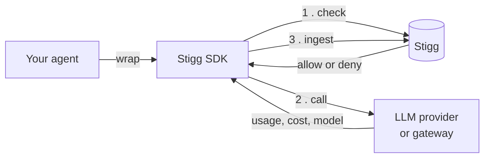

# Stigg Agent SDK

**Know what your agents spend — and stop them before they overspend.**

Check a customer's entitlements, credits or budget **before** a model call, meter what the call
actually used **after** it, and let [Stigg](https://stigg.io) handle the pricing, packaging and
billing behind it.

```bash
npm install @stigg/agent-sdk-js
```

Node 22 or later. Twelve LLM providers and gateways, **and not one of them is a dependency**.

---

## ⚡ Try it in thirty seconds

No API keys. No Stigg account. Nothing to sign up for.

```bash
git clone https://github.com/stiggio/stigg-agent-sdk-ts && cd stigg-agent-sdk-ts
corepack enable && yarn install
yarn example-client-anthropic
```

A built-in mock stands in for both the LLM vendor and the Stigg API — and it is not a stub. The
vendor mock speaks the real wire format, so the vendor's own SDK parses a genuine response and
every field is populated. The Stigg mock implements real entities, budgets and hierarchy, so the
example genuinely hits a denial and tells you which budget caused it.

Add a real key to `.env` later and the same example talks to the real thing.

## 🎯 Quick start

Two lines. Wrap the client you already have, and keep calling it the way you already do.

```ts
import Anthropic from '@anthropic-ai/sdk';
import { StiggAgentSDK } from '@stigg/agent-sdk-js';

const stigg = new StiggAgentSDK(process.env.STIGG_API_KEY);

const client = stigg.wrap(new Anthropic(), {
  stiggContext: { customerId: 'customer-acme', entitlement: { currencyId: 'credits' } },
});

// Checked before it runs, metered after it returns. Nothing else changes.
await client.messages.create({ model, max_tokens: 1024, messages });
```

`wrap()` returns a **copy**. The client you built keeps working ungoverned, which is what makes
the governed one safe to hand around.

When the customer is out of credits, the call does not run:

```ts
import { isAccessDenied } from '@stigg/agent-sdk-js';

try {
  await client.messages.create({ model, max_tokens: 1024, messages });
} catch (error) {
  if (isAccessDenied(error)) {
    // A commercial event, not a crash: offer a top-up.
  }
}
```

**No subscription required.** A credit balance can be checked and drawn with no plan in place, so
the shortest path from nothing to working metering is a currency and a `customerId` — no catalog
modelling first.

## 🧭 How it works



Three things happen around a call you already make:

|                |                      |                                                                                   |
| -------------- | -------------------- | --------------------------------------------------------------------------------- |
| **1. Check**   | before the call      | synchronous, and a refusal is a _commercial_ event — offer a top-up, do not crash |
| **2. Execute** | your call, unchanged | the vendor's own client, own types, own streaming                                 |
| **3. Ingest**  | after the call       | asynchronous and post-hoc; metering must never break a run                        |

Metering and enforcement are deliberately not one component. One fails open, the other fails
closed, and conflating them is how an outage takes an application down.

## 🔌 What it governs

**Providers** — token counts, cache counters, streaming usage:

|                                                                                                                          | Provider  |                                                                                                                         | Provider |
| ------------------------------------------------------------------------------------------------------------------------ | --------- | ----------------------------------------------------------------------------------------------------------------------- | -------- |
|  | Anthropic |   | Mistral  |
|     | OpenAI    |    | Ollama   |
|     | Gemini    |  | TypeSafe |
|       | Groq      |                                                                                                                         |          |

**Gateways** — what was actually _charged_, and which model actually served after routing:

|                                                                                                                           | Gateway               |                                                                                                                           | Gateway    |
| ------------------------------------------------------------------------------------------------------------------------- | --------------------- | ------------------------------------------------------------------------------------------------------------------------- | ---------- |
|     | Amazon Bedrock        |     | LiteLLM    |
|  | Cloudflare Workers AI |  | OpenRouter |
|  | Databricks            |                                                                                                                           |            |

Each binding is written against the _shape a vendor returns_, not against its SDK — so installing
this package pulls in **no vendor packages at all**, and you install only the one you use.

`wrap()` recognises the vendor from the client's own shape. It throws, naming what it knows,
rather than handing back a client that quietly meters nothing.

## 🧩 Beyond a single call

| You want to                           | Use                                                               |
| ------------------------------------- | ----------------------------------------------------------------- |
| Govern a client                       | `stigg.wrap(client, { stiggContext })`                            |
| Gate without a client to wrap         | `stigg.check(context)`                                            |
| Meter something you measured yourself | `stigg.report(context, metrics)`                                  |
| Give an agent its own budget          | `stigg.register({ customerId, agentId, budget })`                 |
| Meter a gateway you operate           | `client.stigg.headers()` out, `stigg.ingestFromHeaders(...)` back |

One wrapped client serves every customer and every agent: the context is an argument, given once
at `wrap` as a default and overridable inside any single call. That is what a multi-tenant server
actually needs.

## 📚 Documentation

- **[The full guide](docs/guide.md)** — every call, what it checks, what it reports, and a runnable
  example per layer of the agent stack
- **[Examples](examples/)** — one script per provider and gateway, all runnable offline
- **[Adding a platform](.claude/skills/govern-new-platform/SKILL.md)** — provider or gateway, and
  what every binding owes

## 🛠️ Development

```bash
yarn lint         # ESLint
yarn typecheck    # tsc over source, tests and examples
yarn test         # the suite, offline
yarn build        # emits dist/
```

See [CONTRIBUTING.md](CONTRIBUTING.md). Issues and pull requests are welcome.

## 🔒 Security

Report vulnerabilities privately, as described in [SECURITY.md](SECURITY.md).

## 📄 License

MIT © Stigg Inc. See [LICENSE](LICENSE).
